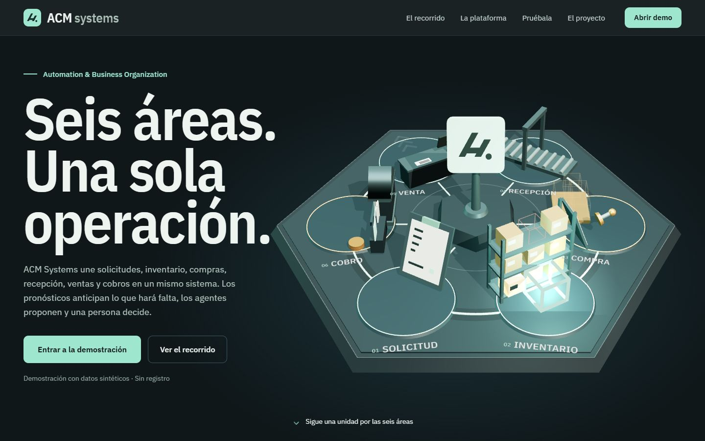

# ACM Systems

**Automation & Business Organization** · Proyecto de seminario desarrollado por **@acarvajalb21 y Mateo**.

ACM Systems reúne el flujo de una distribuidora ficticia en una aplicación web. Conecta solicitudes, inventario por lotes, compras, recepción, ventas, cartera y conciliación bancaria. El escenario y los documentos de la demostración se generan con datos sintéticos.

- **Pronóstico y reposición**. Estima el consumo por referencia y sugiere cuándo y cuánto pedir.
- **Trazabilidad operativa**. Sigue el producto desde la solicitud hasta la venta y el cobro.
- **Agentes supervisados**. Detectan situaciones y proponen acciones que una persona puede revisar y aprobar.
- **Presentación 3D**. Recorre seis etapas de la operación y permite experimentar con un laboratorio de abastecimiento.

El proyecto usa Python 3.13, Django 5.2, SQLite, JavaScript y Three.js.



[Ver el pronóstico de demanda](docs/capturas/06-pronostico-escritorio.png) · [Ver una propuesta de agente](docs/capturas/08-propuesta-agente-escritorio.png) · [Ver más capturas](docs/capturas/)

## Inicio rápido en Windows

Desde la carpeta del repositorio, con Python 3.13 instalado, ejecuta estos comandos en PowerShell.

```powershell
.\INSTALAR.ps1
.\INICIAR_FERIA.ps1
```

Abre la [presentación 3D en el servidor local](http://127.0.0.1:8790/presentacion/) o entra en la [demostración](http://127.0.0.1:8790/). La instalación genera el escenario, los documentos sintéticos y los accesos de prueba en tu equipo. Consulta [los requisitos y las opciones de instalación](#requisitos) para más detalles.

## Presentación interactiva

La presentación está en `/presentacion/`. Abre con una maqueta 3D del circuito de la operación (seis estaciones
unidas a un núcleo), un recorrido que se explora con scroll, selector o reproducción guiada, tres vistas
manipulables del producto y un laboratorio de abastecimiento. Las interacciones de la landing son ejemplos en
memoria: no crean pedidos ni modifican la base. El botón «Entrar a la demostración» abre la aplicación funcional
descrita a continuación.

Identidad visual compartida: grafito `#0f1719`, menta `#9ee6ce`, ámbar `#ffbe74` y coral `#ed9b86`, con
IBM Plex Sans Condensed en los titulares. La portada, el acceso, la navegación y los indicadores usan esta familia.
Las animaciones respetan la preferencia de movimiento reducido; menús, selectores y controles se operan con teclado.
No hay dependencias remotas: el motor 3D (Three.js 0.187.0) se sirve desde `static/vendor/`.

## Escenario de demostración

Demostración con datos sintéticos de un caso empresarial: una distribuidora de insumos (mantenimiento, adhesivos,
sellantes y recubrimientos) que maneja su inventario por lotes y vencimientos. La aplicación reúne en un solo lugar
solicitudes, inventario, compras, recepción, ventas, cartera y banco; pronostica el consumo de cada referencia para
sugerir cuándo y cuánto pedir, y usa agentes que proponen acciones para que una persona las apruebe.

Frase de presentación:

> Desarrollamos una aplicación a partir del trabajo con una empresa para integrar información operativa, anticipar
> necesidades de abastecimiento y asistir la ejecución de procesos mediante modelos predictivos y agentes
> supervisados. Esta demostración utiliza un caso empresarial y datos sintéticos.

La empresa del escenario, `Distribuidora Ejemplo S.A.S.`, es ficticia. Ningún dato proviene de una organización
real. El sistema contable, el banco, el correo y la mensajería son simulados: nada sale de este equipo.

## Requisitos

- Windows 10 u 11 con PowerShell.
- Python 3.13 (probado con 3.13.11). Las dependencias están fijadas en `requirements-lock.txt` (Django 5.2).
- Un navegador reciente basado en Chromium, que es donde se revisaron las pantallas. Otros navegadores no se han
  verificado.
- Conexión a internet solo para instalar las dependencias. Una vez instalada, la aplicación funciona sin conexión.

## Instalar, iniciar, restaurar y reiniciar

Los cuatro guiones se ejecutan desde la carpeta del proyecto.

| Guion | Qué hace | Equivalente con `manage.py` |
|---|---|---|
| `.\INSTALAR.ps1` | Crea el entorno `.venv`, instala dependencias, prepara la base local y genera el escenario. | `py -3.13 -m venv .venv` · `.venv\Scripts\python.exe -m pip install -r requirements-lock.txt` · `.venv\Scripts\python.exe manage.py migrate` · `.venv\Scripts\python.exe manage.py reiniciar_feria --si` |
| `.\INICIAR_FERIA.ps1` | Enciende el servidor local. La ventana debe quedar abierta; `Ctrl+C` lo detiene. | `.venv\Scripts\python.exe manage.py migrate` · `.venv\Scripts\python.exe serve.py` |
| `.\RESTAURAR_FERIA.ps1` | Devuelve la base al escenario inicial en segundos, a partir de la copia guardada en el último reinicio. No hace falta detener el servidor. | `.venv\Scripts\python.exe manage.py restaurar_feria --si` |
| `.\REINICIAR_FERIA.ps1` | Borra la base local, genera de nuevo el escenario para la fecha de hoy, guarda la copia inicial y lo verifica. Requiere el servidor detenido. | `.venv\Scripts\python.exe manage.py reiniciar_feria --si` · `.venv\Scripts\python.exe manage.py verificar_escenario` |

Notas:

- Si PowerShell no permite ejecutar guiones, use `powershell -ExecutionPolicy Bypass -File .\INSTALAR.ps1` (y lo
  mismo con los demás).
- Al usar `manage.py` directamente desde PowerShell, fije antes la codificación de salida:
  `$env:PYTHONIOENCODING = 'utf-8'`. Los guiones ya lo hacen.
- `INSTALAR.ps1` busca Python 3.13 en el lanzador `py` y en el `python` del sistema. Si no lo encuentra, indique la
  ruta del intérprete: `.\INSTALAR.ps1 -Interprete "C:\ruta\a\python.exe"`.
- Descomprima el paquete en una carpeta de ruta corta (por ejemplo `C:\feria`). En una ruta muy larga la instalación
  de dependencias falla por el límite de 260 caracteres de Windows.
- Generar el escenario completo (24 meses simulados) tarda unos minutos. En el equipo donde se preparó este paquete
  tardó entre tres minutos y medio y seis, según la carga del equipo.
- Detenga el servidor antes de reiniciar: mientras está encendido, la base no se puede borrar y el reinicio lo avisa
  sin cambiar nada.
- Restaurar y reiniciar no son lo mismo. `RESTAURAR_FERIA.ps1` sirve entre una exposición y la siguiente del mismo
  día: descarta lo hecho desde el último reinicio, cierra las sesiones abiertas (se vuelve a entrar con un clic en
  el perfil) y deja los casos preparados como estaban. `REINICIAR_FERIA.ps1` se usa al empezar cada día, porque los
  casos dependen de la fecha y la copia inicial es del día en que se generó.
- `REINICIAR_FERIA.ps1` admite `-Fecha 2026-11-18` y `-Semilla 4711`; `reiniciar_feria`, `--fecha` y `--semilla`.
  Con la misma fecha y la misma semilla se obtienen los mismos datos.

## Abrir la demostración

Dirección local: http://127.0.0.1:8790/

La pantalla de ingreso ofrece los perfiles de demostración (Dirección, Administración, Inventario, Recepción,
Contabilidad, Facturación y dos solicitantes). Hay dos maneras de entrar:

- Con un clic en el perfil. Este selector solo aparece y solo funciona cuando el navegador está en el mismo equipo
  que ejecuta el servidor. No concede permisos: inicia sesión como esa cuenta y cada pantalla sigue comprobando el
  perfil en el servidor.
- Con usuario y clave. Las claves se generan en cada reinicio y quedan en `datos/ACCESOS_DEMO.md`. Ese archivo es
  local: se crea en cada equipo y no debe compartirse.

Para una primera vista, entre como Dirección y abra Inteligencia → Recorrido guiado. El guion completo está en
`docs/GUION_EXPOSICION.md`.

## Comprobar que todo está bien

```
.venv\Scripts\python.exe manage.py verificar_escenario
.venv\Scripts\python.exe manage.py test
```

- `verificar_escenario` revisa que los saldos cuadren con sus documentos (inventario, compras, cuentas por pagar,
  cartera y banco) y que los casos preparados para la demostración existan. Termina con código 1 si algo falla. Con
  `--reproducibilidad` genera además el escenario dos veces en carpetas temporales y compara los resultados; esa
  opción tarda varios minutos.
- `test` ejecuta las pruebas automáticas (266 al preparar esta documentación; una prueba lenta de reproducibilidad
  se omite salvo que se defina `FERIA_PRUEBAS_LENTAS=1`). Tardan cerca de un minuto y medio, usan una base aparte
  (`datos/test.sqlite3`) y no modifican la base de la demostración. Ninguna prueba sale a internet.

Otros comandos útiles: `manage.py agentes --lista` (agentes, estado y próxima revisión) y `manage.py aprendizaje`
(estado de los tres modelos).

## Documentación

| Documento | Contenido |
|---|---|
| [docs/GUION_EXPOSICION.md](docs/GUION_EXPOSICION.md) | Guion de 5 a 7 minutos en siete pasos, preguntas frecuentes y lista de comprobación. |
| [docs/ARQUITECTURA.md](docs/ARQUITECTURA.md) | Aplicaciones, flujo de una operación, configuración, seguridad e integraciones simuladas. |
| [docs/MODELOS.md](docs/MODELOS.md) | Pronóstico y reposición, identificación de pagos y cobranza: método, evaluación y cifras medidas. |
| [docs/AGENTES.md](docs/AGENTES.md) | Qué hace cada agente, quién aprueba y cómo se evita duplicar efectos. |
| [docs/COPILOTO.md](docs/COPILOTO.md) | Resumen del copiloto para quien expone. El detalle técnico está en [copiloto/README.md](copiloto/README.md). |
| [docs/DATOS_SINTETICOS.md](docs/DATOS_SINTETICOS.md) | Cómo se genera el escenario, qué contiene, casos preparados y verificación. |
| [docs/MATRIZ_CAPACIDADES.md](docs/MATRIZ_CAPACIDADES.md) | Tabla por capacidad: qué hace, mejoras, qué es simulado y qué no se incluye. |
| [docs/SUPUESTOS_Y_LIMITES.md](docs/SUPUESTOS_Y_LIMITES.md) | Supuestos de negocio y de modelos, lo simulado y lo no verificado. |
| [docs/INFORME_VERIFICACION.md](docs/INFORME_VERIFICACION.md) | Comprobaciones funcionales, visuales y de confidencialidad realmente ejecutadas, con sus límites. |
| [docs/capturas/](docs/capturas/) | Capturas de las pantallas principales en escritorio y celular, y la grabación del recorrido guiado (`recorrido.webm`, 4 min 28 s). |
| [static/LICENCIAS.md](static/LICENCIAS.md) | Licencias de tipografías, íconos y biblioteca de lectura de códigos. |

## Alcance

Los resultados de los modelos que muestra la aplicación demuestran funcionamiento y metodología sobre datos
sintéticos. No prueban eficacia en una empresa real. Los límites están descritos en
`docs/SUPUESTOS_Y_LIMITES.md`.

## Rediseño interactivo 3D · 21 de noviembre de 2026

Dirección: «El circuito de la operación». La empresa se muestra como una maqueta: seis estaciones (solicitud,
inventario, compra, recepción, venta y cobro) sobre un riel circular, unidas por radios a un núcleo con la marca,
que representa el sistema único. Una unidad recorre el circuito y cambia de estado: contorno menta (necesidad),
contorno ámbar (pedido), caja con lote bajo el escáner (recepción), caja con sello (venta) y moneda (cobro).

| Parte | Qué hace | Archivos |
|---|---|---|
| Portada | Titular «Seis áreas. Una sola operación.» y la maqueta completa, siempre en movimiento: la cámara gira despacio a su alrededor, la unidad recorre sola el circuito y cada estación se activa a su paso. Un clic o toque en una estación lleva a su explicación. | `feria/templates/feria/presentacion.html`, `static/modulos/presentacion.css` |
| Recorrido | Sección fijada con `position: sticky` y scroll nativo: la cámara orbita de estación en estación. Selector de seis etapas (clic, toque, flechas, Inicio y Fin), ficha vinculada y «Reproducir recorrido», que se detiene con cualquier gesto de desplazamiento y termina en «Repetir recorrido». | `static/modulos/presentacion.js`, `static/modulos/escena3d.js` |
| La plataforma | Tres vistas: inventario por lote con un despacho de ejemplo que descuenta primero el lote que vence primero; pronóstico; y agentes con la secuencia situación detectada → motivo → revisión humana → resultado simulado, con aprobar, rechazar y reiniciar. | los mismos |
| Laboratorio | Dos deslizadores (consumo y plazo). Las cajas muestran stock, stock de sobra y unidades por reponer (1 caja = 20 ud.); la línea de semanas muestra hasta dónde alcanza el stock, cuándo llega el pedido y el tramo sin existencias. | los mismos |
| Acceso y aplicación | Mismo grafito y tipografía de rótulo; la maqueta aparece en el acceso (desde 981 px de ancho). | `static/app.css`, `templates/auth_base.html` |

Integración técnica:

- **Motor 3D:** Three.js 0.187.0 copiado a `static/vendor/three-0.187.0/` (módulos reducidos y su copia `.gz`).
  La escena es geometría procedimental: no descarga modelos ni texturas. Licencias en `static/LICENCIAS.md`.
- **Política de seguridad sin cambios:** `script-src 'self'` y `style-src 'self'`. No hay scripts ni estilos en
  línea, evaluación dinámica, trabajadores ni peticiones a otros servidores. `presentacion.js` importa la escena
  con `import()` después del evento `load`; hasta entonces se ve el póster `static/presentacion/maqueta.webp`.
- **Alternativa sin WebGL:** si el navegador no ofrece WebGL 2, si se pierde el contexto gráfico o si la dirección
  lleva `?3d=0`, la portada conserva el póster y el recorrido pasa a un selector con los seis dibujos SVG y sus
  fichas. Sin JavaScript se lee la primera estación y una nota.
- **Movimiento reducido:** la maqueta se dibuja quieta, un fotograma por cambio, y la sección no se fija; las
  estaciones cambian por corte. Las transiciones y animaciones CSS se anulan.
- **Rendimiento de la escena:** densidad de píxeles limitada (2 en escritorio, 1,5 con puntero táctil), pausa
  cuando el escenario sale de pantalla o la pestaña se oculta, y un regulador que baja la densidad y después las
  sombras si el equipo no sostiene el ritmo.
- **Backend:** rutas, permisos y lógica sin cambios. La vista de la presentación solo añade al contexto las 35
  casillas del laboratorio.

Verificación realizada el 21 de noviembre de 2026 (Chromium 157 con Playwright, GPU AMD Radeon 780M):

- `manage.py test feria.test_presentacion`: 10 pruebas aprobadas, dos de ellas nuevas (motor local y diferido con
  alternativa estática; ejemplos rotulados y sin formularios). `manage.py check` sin avisos.
- Suite completa: 291 pruebas, 289 aprobadas y 2 omitidas. Se ajustó una prueba que fallaba desde antes del rediseño:
  `feria.tests.ResetSafetyTests.test_scripts_use_no_absolute_paths_and_call_the_expected_commands` buscaba el texto
  `-m venv .venv` en `INSTALAR.ps1`, que pasa esos argumentos como lista; ahora comprueba `'-m', 'venv', '.venv'`.
  El guion de instalación no se modificó.
- Navegador, sin errores ni avisos de consola: portada, las seis estaciones por selector, por teclado y por clic en
  la maqueta, reproducción guiada completa, despacho y reinicio, aprobar, rechazar y reiniciar, laboratorio en
  mínimos (necesidad 20, reponer 0) y máximos (necesidad 700, reponer 580) y su restablecimiento, preguntas, menú
  móvil con Escape, y entrada a la demo desde el cierre hasta el Resumen con un perfil.
- Sin desborde horizontal a 320, 390, 768 y 1440 px. Los controles del recorrido quedan dentro de la pantalla a
  1440 × 900, 1440 × 780, 1366 × 768, 1280 × 720 y 1024 × 768.
- Alternativa `?3d=0` y movimiento reducido emulado, en escritorio y celular.
- Medición de laboratorio contra el servidor local, sin caché, tres cargas por condición:

  | Condición | LCP | CLS | Maqueta lista | Fluidez |
  |---|---|---|---|---|
  | Escritorio 1440 × 900 | 92 a 120 ms | 0 | 0,30 a 0,35 s | 145 fotogramas por segundo en portada y recorrido |
  | Celular emulado 390 × 844, CPU ×4, 9 Mbps y 85 ms | 0,78 a 0,88 s | 0 | 2,0 a 2,1 s | 56 a 79 fotogramas por segundo; peor fotograma 21 a 49 ms |

  Transferencia en frío: 614 KB en 18 peticiones, de ellos 238 KB de JavaScript comprimido. La construcción de la
  escena deja una tarea larga de 145 a 177 ms en escritorio y de unos 510 ms con CPU ×4, después del primer pintado.
- Revisión visual con capturas a 1440 y 390 px: `docs/CRITICA_VISUAL_2026-11-21.md`, con sus tres
  problemas prioritarios corregidos y medidos.

Animación continua (añadida después de la primera entrega): la estación activa repite su acción en bucle cada 5,2
segundos (la solicitud se escribe, el sello aprueba la compra, la factura sale, las monedas se apilan) y la cámara
mantiene un vaivén leve. Comprobado con secuencias de capturas de la portada, Compra y Cobro; con movimiento
reducido nada de esto se ejecuta.

Para ver la animación hay que abrir la página en un navegador con la pestaña visible. Un navegador pausa las
pestañas en segundo plano, y el panel integrado de algunas herramientas las trata así: ahí la maqueta se ve quieta.

Límites: no se probó en un teléfono físico, en Safari ni en Firefox, ni con lector de pantalla. Las cifras son de
laboratorio en un solo equipo; no son datos de usuarios ni una puntuación de Lighthouse. La pérdida de contexto
WebGL tiene manejador pero no se provocó en la prueba.

Capturas: `docs/capturas/acm3d-01` a `acm3d-17` (escritorio, tablet y celular). Paquete:
`dist/acm-systems-interactivo-3d.zip`; los paquetes anteriores se conservan.

## Auditoría y rediseño · 20 de noviembre de 2026

| Antes | Después | Motivo |
|---|---|---|
| Nombre descriptivo largo y el mismo peso visual en toda la portada | ACM Systems, símbolo propio y propuesta breve | Identificar el producto y entenderlo desde el primer pantallazo. |
| Dos bloques extensos de texto al inicio | Panel de producto con tres vistas seleccionables | Mostrar qué hace el sistema antes de explicar sus detalles. |
| Seis escenas estáticas seguidas | Recorrido por estaciones con estado activo y contenido contextual | Explorar el flujo con clic, toque o teclado. |
| Descripción de pronósticos y aprobación | Laboratorio recalculable y aprobación de ejemplo con reinicio | Entender los cambios y distinguir la muestra de la aplicación real. |
| Portada y aplicación sin una identidad destacada | Colores y marca compartidos entre landing, acceso y aplicación | Mantener continuidad al entrar a la demostración. |

Referencias consultadas localmente: `MECEDGE/sitio` (contraste, composición de documentos y ejemplos manipulables)
y `YOUR iDEa` (hero amplio, producto interactivo y jerarquía). Implementación propia en Django, CSS y JavaScript
nativo, manteniendo IBM Plex Sans, los iconos y las seis escenas del proyecto.

Verificación del rediseño: 37 pruebas existentes aprobadas (presentación, experiencia, resumen, app instalable
y aislamiento de configuración), `manage.py check` y sintaxis JavaScript correctos. Revisión en Chromium de
las tres vistas, las seis estaciones, aprobación/reinicio, rangos mínimo y máximo del laboratorio, menú móvil
y navegación con teclado. Revisión responsive a 320, 390, 768 y 1440 px; capturas actualizadas en `docs/capturas/acm-*`.
No se midieron Core Web Vitals ni se ejecutó la suite funcional completa.

El ZIP original `plataforma-operaciones-feria.zip` se conserva. El paquete actualizado es `acm-systems-feria.zip`.
El contenido de equipo sigue siendo editable en `config/presentacion.json`; no se inventaron nombres ni contactos.
